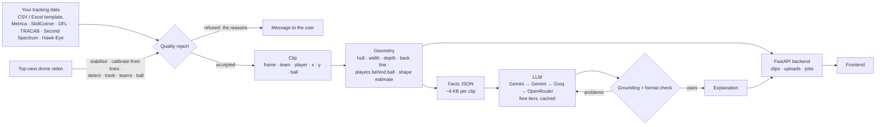

# ⚽ Vyuh (व्यूह) · football tactical replay

*Vyuh* is Sanskrit for a battle formation (the Mahabharata's Chakravyuh is the famous one); a football formation is the same idea.

[](https://github.com/Mohitoo6/football-tactical-replay/actions/workflows/tests.yml)

Replays real football moments from open player-tracking data, draws each team's shape as it moves, and has an LLM explain the tactics **using only facts the code has measured**. Every number in the explanation is checked automatically.


*Musiala's 89th-minute winner (1. FC Köln 1–2 FC Bayern München, 27 May 2023). Shaded areas are each team's outfield shape; lines join team-mates in the same line; the numbers below update every frame.*

## What it does

Pick a clip in the web app and you get:

- **The replay:** all 22 players and the ball, from 25-frames-per-second optical tracking.
- **Shape overlays:** each team's convex hull, its back line, and width, depth and area, computed every frame.
- **A coach's explanation:**
  - *What happened*: facts only.
  - *Coach's view*: general football principles applied to those facts.
  - *Key numbers*.

  A badge confirms that every number, match time and formation in the text appears in the measured facts.

Example output for the clip above (abridged):

> **Coach's view** — Köln’s area contracted from 757 m² to 388 m² with a back line at 10 metres; this suggests a very deep, compact defensive block designed to deny space near goal, but it often gives away territory and time on the ball around the penalty area.

## How it works



**Core design principle:** positions come from real tracking data, so there is no computer-vision guesswork at the bottom of the stack. The geometry is deterministic, tested code. The LLM sits only at the top and narrates facts it is given. It never computes or invents numbers, and a checker enforces that.

Key decisions, with alternatives and evidence, are in [`DECISIONS.md`](DECISIONS.md).

## Results

| What | How it was measured | Result |
|---|---|---|
| Data quality | 2 full matches, ~6.2 M player positions | 0 positions > 5 m off the pitch; ball never missing; tracking glitches in 0.004 % of moves |
| Orientation | Goalkeeper side per half, 2 matches | 4 / 4 halves correct |
| Generalisation | Ran the pipeline on a second match it was not built on | Worked after fixing 5 issues the first match never showed (D14) |
| Formation estimate | 5-min windows vs official DFL lineups | Settled defensive block: back line 100 %, official shape in top-2 79 %. Team in possession: poor (0–16 %) |
| LLM grounding | 4 clips, prompt v3 | 4 / 4 pass; a naive prompt on the same facts invented a number and two names (caught) |
| Tests | `uv run pytest` | 92 passing (+26 video tests with `--group video`), including the app and LLM layer with fake clients (no network) |

Details: [`evals/formation_eval_J03WMX.md`](evals/formation_eval_J03WMX.md), [`evals/formation_eval_J03WN1.md`](evals/formation_eval_J03WN1.md), [`evals/llm/README.md`](evals/llm/README.md).

## From drone video to coaching (Phase 7)

The same pipeline also runs on **raw top-view drone video**, with no tracking provider. The system finds the players and the ball itself:

1. Stabilise the hovering drone's drift.
2. Build an empty-pitch image (per-pixel median of the frames).
3. Calibrate from the painted pitch lines.
4. Detect players as blobs that differ from the empty pitch.
5. Track them with a colour-aware tracker, split teams by shirt colour (with an offside-logic goalkeeper rule) and follow the ball.

The result is exported as a normal clip (`clips/drone-0600-0630`), so the overlays and the AI coach work on it unchanged. It works on any clip file:

```bash
uv sync --group video
uv run --group video python scripts/process_video.py my_drone_clip.mp4 --render --explain
```

Before any tracking, the pipeline prints a **quality report**:
- clip length
- pitch outline shape
- calibration stable over the clip
- camera holding still
- plausible player count
- enough pixels per metre of pitch (1080p of a full pitch is fine; 720p is not)

If a check fails, it refuses the clip instead of producing wrong positions.

Measured on **20 × 30 s SoccerTrack segments** of one match (13 used while building, 7 never seen; five of these were processed before their ground truth was downloaded). The dataset's ground truth is used **only for scoring**, with its calibration corrected per segment because the drone drifts ([evals/video](evals/video/README.md), [D19–D30](DECISIONS.md)):

| What | 13 tuned segments: median (worst) | 6 accepted unseen segments: median (worst) |
|---|---|---|
| Players found (recall) | 98.6% (97.7%) | 96.9% (80.0%) |
| Position error, automatic calibration (no hand-marked points) | 0.35 m (0.52 m) | 0.44 m (0.55 m) |
| Identity kept (purity) | 97.4% (91.4%) | 92.5% (84.6%) |
| Correct team | 98.2% (94.3%) | 92.5% (89.5%) |
| Ball correct, all frames | 63% (34%) | 55% (22%) |

On unseen data the pipeline is clearly weaker than on the segments it was tuned on; that gap is the honest number. One unseen segment was refused by the quality report (11:00), although its positions were good. Another (16:00) was accepted with only 80% of players found.

The ball is often hidden at players' feet. A full-resolution ball detector raises this on 5 of 6 test segments, but it is not adopted yet (D25).

Speed: ~2 min per 30 s of 4K video on an Apple M2 (offline).

A pretrained deep detector (RF-DETR, tiled) found only 43% of players from straight above, at 100× the cost. The classical method won here.

**Robustness** ([evals/video/robustness.md](evals/video/robustness.md), [D27](DECISIONS.md)): one segment was edited the ways real clips differ — rotated 90° and 180°, cropped, 30% darker, 1080p, 20 s, 25 fps — and the pipeline still found 98% of players within 0.55 m on every copy. A copy with a goal line cut off, and a 720p copy, were refused. The first run of this suite found three real bugs (line grouping, a fixed brightness threshold, pixel-sized blobs), now fixed and covered by tests.

Limits: hovering top-down camera, whole pitch outline visible, one ground tested so far.

## Experiment: TV broadcast footage (branch `broadcast-experiment`)

We also tried the usual TV camera, which pans and zooms:
- the camera calibrated in every frame;
- players and ball found with RF-DETR;
- the analysis drawn on the footage.

On one hand-labelled Euro 2020 clip it found 90% of players. The ball, though, could be confirmed in only ~20% of frames. It works only on the main camera of professional stadiums, and free TV footage to test it on does not exist (broadcast rights). We kept the drone pipeline as the product and moved this experiment to its own branch. The measurements and the reasons are in [D28, D29 and D31](DECISIONS.md) and [evals/broadcast](evals/broadcast/README.md).

## Use your own data

Two ways in, one analysis. Both go through a quality report that refuses data it cannot analyse, and says why.

1. **Tracking (coordinate) data:**
   - **Our template**, CSV or Excel ([`templates/tracking_template.csv`](templates/tracking_template.csv)), with one row per player (and the ball) per moment:

     | Column | Meaning |
     |---|---|
     | `time_s` | seconds from the start of the clip |
     | `team` | `home`, `away` or `ball` |
     | `player` | name or number |
     | `x`, `y` | position |
     | `jersey`, `position` | optional; `GK` marks a keeper, otherwise the deepest player in front of goal is taken |

     Positions can be in metres from the centre spot, metres from a corner, or 0–1 along each side. A full example is [`templates/example_musiala_winner.csv`](templates/example_musiala_winner.csv).
   - **Provider formats** through [kloppy](https://kloppy.pysport.org): Metrica, SkillCorner, Sportec/DFL, TRACAB, Second Spectrum or Hawk-Eye files, cut to a window of up to 120 s.
   - **Tested on:**
     - the example file, which reproduces the bundled clip to 0.01 m;
     - Metrica open data (game 1);
     - SkillCorner open data (Brisbane v Perth, 10 fps);
     - TRACAB, Second Spectrum and Hawk-Eye: only kloppy's small sample files (these feeds are licensed to clubs, so we have no full match; see D37).
2. **A top-view drone video:** see [above](#from-drone-video-to-coaching-phase-7). It runs locally (minutes of processing), not on a free server.

**Accepted data needs:**
- 3–120 s at 5–60 frames per second;
- at least 7 players per team;
- positions on the pitch (otherwise the units are probably wrong).

**Ball:** without the ball the shapes are still measured, but there are no ball-based facts.

## Backend API

```bash
uv run uvicorn tactics.api:app --reload     # interactive docs at http://localhost:8000/docs
```

| Endpoint | What it does |
|---|---|
| `GET /api/clips` | every clip (bundled and uploaded) |
| `GET /api/clips/{id}?step=2` | frames, players, ball, team shapes (hull, width, depth, area, back line), facts, explanation; ~76 KB gzipped |
| `POST /api/clips/{id}/explanation` | the coach's explanation (cached; one LLM call on a miss) |
| `POST /api/uploads/tracking` | template CSV/Excel → clip, or the reasons it was refused |
| `POST /api/uploads/provider` | Metrica / SkillCorner / Sportec / TRACAB / Second Spectrum / Hawk-Eye files + time window → clip |
| `POST /api/uploads/drone`, `GET /api/jobs/{id}` | drone video as a background job with progress (local, needs `--group video`) |
| `GET /api/template`, `GET /api/template/example` | the template and the example file |

Uploaded clips are stored in `data/user_clips/` (git-ignored).

## Run it

Requirements: macOS or Linux, Python 3.11+, [uv](https://docs.astral.sh/uv/). The four clips, their videos and explanations are in the repo, so **the app needs no data download and no API keys**.

```bash
git clone https://github.com/Mohitoo6/football-tactical-replay.git
cd football-tactical-replay
uv sync
uv run uvicorn tactics.api:app --reload        # backend API: http://localhost:8000/docs
uv run streamlit run app/streamlit_app.py      # quick test viewer: http://localhost:8501
uv run pytest                                  # 92 tests (video tests skip without --group video)
```

### Rebuild everything from raw data (optional)

1. Download a match's three XML files (match information, events, positions) from the [Sportec Open DFL dataset on figshare](https://doi.org/10.6084/m9.figshare.28196177) into `data/raw/dfl/` (git-ignored). Each positions file is ~400 MB.
2. Then:

```bash
uv run python scripts/check_match.py J03WMX        # health report + suggested clips for every goal
uv run python scripts/build_clips.py               # clips defined in clips/clips.toml
uv run python scripts/render_clip.py --for-app     # videos (needs ffmpeg: brew install ffmpeg)
cp .env.example .env                               # add free API keys (Gemini, Groq, OpenRouter)
uv run python scripts/generate_explanations.py     # cached per clip; re-runs cost nothing
uv run python scripts/evaluate_formations.py J03WMX
```

## Project layout

```
src/tactics/
  service.py the backend in one place: list, read, create (template, provider, drone video) and explain clips
  api.py     FastAPI app over service.py
  data/      load DFL tracking with kloppy, orient, validate, build/save clips; upload.py reads user data
  video/     drone video to tracking: stabilise, calibrate from lines, detect, track, teams, ball (Phase 7)
  geometry/  shape metrics, formation template matching, formation-line links
  viz/       pitch drawing and animation (one FramePainter for stills and video)
  ai/        facts summary, prompt, LLM client with fallbacks/cache/repair, grounding check
templates/   upload template and a full example file
app/         Streamlit test viewer
scripts/     offline pipeline: check_match, build_clips, render_clip, generate_explanations, evaluate_formations
clips/       committed clips: players/ball parquet, meta, summary, explanation, video
evals/       formation and LLM evaluations
tests/       92 tests + 26 video tests
```

## Limitations

- **Data:** only the DFL open dataset is supported end to end (7 matches available; 2 used). Another provider needs its own loader.
- **Formation estimate:** reliable for a settled defensive block, unreliable for a team in possession, which reshapes (e.g. 4-2-3-1 on paper, 3-4-3 with the ball). It needs at least 10 outfield players and 5 s of open play, otherwise it shows "n/a".
- **Ball while out of play:** the provider freezes its position, so it is hidden.
- **"Ball carrier"** means the nearest player to the ball, not confirmed possession.
- **Grounding check:** it confirms each number, time and formation exists in the facts, but not that it is attached to the right team or metric. It cannot judge the soundness of coaching reasoning. Both need human review (`evals/llm/`).
- **Free tiers:** Gemini allowed 20 requests per day per model when measured (2026-10-11). Explanations are generated offline and cached; the app makes no LLM calls.
- **Drone video (Phase 7):** tested on one match and one ground (plus edited copies: rotated, cropped, darker, 1080p, 25 fps). It needs a hovering, top-down camera with the whole pitch visible and at least 10 px per metre. A keeper who barely moves can fade into the background. No player names or goals are detected from video.

## Data and attribution

- Tracking and event data: **Sportec Open DFL Tracking and Event Data**. Bassek, M., Rein, R., Weber, H. & Memmert, D. *An integrated dataset of spatiotemporal and event data in elite soccer.* Scientific Data 12, 195 (2025). doi:[10.1038/s41597-025-04505-y](https://doi.org/10.1038/s41597-025-04505-y). Licensed **CC-BY 4.0**.
- Drone video and ground truth for Phase 7: **SoccerTrack**, Scott et al., CVPR Workshops 2022 ([Kaggle](https://www.kaggle.com/datasets/atomscott/soccertrack)), LGPL-3.0. Raw videos are not redistributed; `clips/drone-0600-0630` contains positions we computed and a rendered video.
- Metrica Sports sample data ([github.com/metrica-sports/sample-data](https://github.com/metrica-sports/sample-data)) and SkillCorner open data ([github.com/SkillCorner/opendata](https://github.com/SkillCorner/opendata)) were used to test the upload path (not redistributed).
- Built with kloppy, mplsoccer, numpy, scipy, pandas, matplotlib, Streamlit and the OpenAI-compatible APIs of Google Gemini, Groq and OpenRouter.

## License

- **Code:** [MIT](LICENSE).
- **Data:** the tracking-derived files in `clips/` (positions, summaries, videos) come from the Sportec Open DFL dataset and remain under **CC-BY 4.0**. If you reuse them, credit Bassek et al. (2025) as above.

## Authors

Co-built by two brothers:

- **Rohit** ([@Rohit-0612](https://github.com/Rohit-0612)): data pipeline, orientation and validation, geometry and formation detection, visualisation (Phases 1–4).
- **Mohit** ([@Mohitoo6](https://github.com/Mohitoo6)): AI explanation layer (facts summary, prompts, fallbacks, caching, grounding and repair), evaluation, Streamlit app (Phases 5–6); video-to-tracking from drone footage (Phase 7) and the TV-footage experiment (Phase 8).

Developed with Claude Code as a pair programmer; every decision and its evidence is recorded in `DECISIONS.md`.
