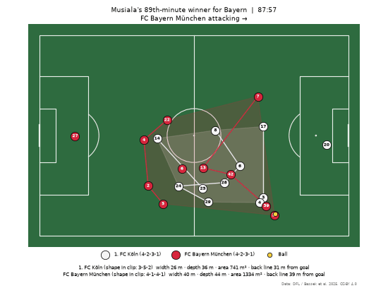
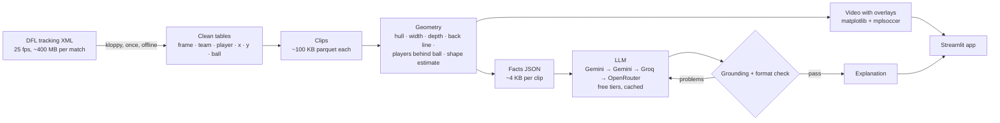

# ⚽ Football Tactical Replay

[](https://github.com/Mohitoo6/football-tactical-replay/actions/workflows/tests.yml)

Replays real football moments from open player-tracking data, draws each team's shape as it moves, and has an LLM explain the tactics **using only facts the code has measured**. Every number in the explanation is checked automatically.



*Musiala's 89th-minute winner (1. FC Köln 1–2 FC Bayern München, 27 May 2023). Shaded areas are each team's outfield shape; lines join team-mates in the same line; the numbers below update every frame.*

## What it does

Pick a clip in the web app and you get:

- **The replay:** all 22 players and the ball, from 25-frames-per-second optical tracking.
- **Shape overlays:** each team's convex hull, its back line, and width, depth and area, computed every frame.
- **A coach's explanation:**
  - *What happened*: facts only.
  - *Coach's view*: general football principles applied to those facts.
  - *Key numbers*.

  A badge confirms that every number, match time and formation in the text appears in the measured facts.

Example output for the clip above (abridged):

> **Coach's view** — Köln’s area contracted from 757 m² to 388 m² with a back line at 10 metres; this suggests a very deep, compact defensive block designed to deny space near goal, but it often gives away territory and time on the ball around the penalty area.

## How it works



**Core design principle:** positions come from real tracking data, so there is no computer-vision guesswork at the bottom of the stack. The geometry is deterministic, tested code. The LLM sits only at the top and narrates facts it is given. It never computes or invents numbers, and a checker enforces that.

Key decisions, with alternatives and evidence, are in [`DECISIONS.md`](DECISIONS.md).

## Results

| What | How it was measured | Result |
|---|---|---|
| Data quality | 2 full matches, ~6.2 M player positions | 0 positions > 5 m off the pitch; ball never missing; tracking glitches in 0.004 % of moves |
| Orientation | Goalkeeper side per half, 2 matches | 4 / 4 halves correct |
| Generalisation | Ran the pipeline on a second match it was not built on | Worked after fixing 5 issues the first match never showed (D14) |
| Formation estimate | 5-min windows vs official DFL lineups | Settled defensive block: back line 100 %, official shape in top-2 79 %. Team in possession: poor (0–16 %) |
| LLM grounding | 4 clips, prompt v3 | 4 / 4 pass; a naive prompt on the same facts invented a number and two names (caught) |
| Tests | `uv run pytest` | 73 passing (+32 video tests with `--group video`), including the app and LLM layer with fake clients (no network) |

Details: [`evals/formation_eval_J03WMX.md`](evals/formation_eval_J03WMX.md), [`evals/formation_eval_J03WN1.md`](evals/formation_eval_J03WN1.md), [`evals/llm/README.md`](evals/llm/README.md).

## From drone video to coaching (Phase 7)

The same pipeline also runs on **raw top-view drone video**, with no tracking provider. The system finds the players and the ball itself:

1. Stabilise the hovering drone's drift.
2. Build an empty-pitch image (per-pixel median of the frames).
3. Calibrate from the painted pitch lines.
4. Detect players as blobs that differ from the empty pitch.
5. Track them with a colour-aware tracker, split teams by shirt colour (with an offside-logic goalkeeper rule) and follow the ball.

The result is exported as a normal clip (`clips/drone-0600-0630`), so the overlays and the AI coach work on it unchanged. It works on any clip file:

```bash
uv sync --group video
uv run --group video python scripts/process_video.py my_drone_clip.mp4 --render --explain
```

Before any tracking, the pipeline prints a **quality report**:
- clip length
- pitch outline shape
- calibration stable over the clip
- camera holding still
- plausible player count
- enough pixels per metre of pitch (1080p of a full pitch is fine; 720p is not)

If a check fails, it refuses the clip instead of producing wrong positions.

Measured on **15 × 30 s SoccerTrack segments** of one match (13 used while building, 2 never seen). The dataset's ground truth is used **only for scoring**, with its calibration corrected per segment because the drone drifts ([evals/video](evals/video/README.md), [D19–D30](DECISIONS.md)):

| What | Median (worst) over the 13 tuned segments | 2 unseen segments |
|---|---|---|
| Players found (recall) | 98.6% (97.7%) | 96.3%, 99.1% |
| Position error, automatic calibration (no hand-marked points) | 0.35 m (0.52 m) | 0.55 m, 0.44 m |
| Identity kept (purity) | 97.4% (91.4%) | 91.4%, 96.6% |
| Correct team | 98.2% (94.3%) | 91.9%, 92.7% |
| Ball correct, all frames | 63% (34%) | 42%, 68% |

The ball is often hidden at players' feet. A full-resolution ball detector raises this on 5 of 6 test segments, but it is not adopted yet (D25).

Speed: ~2 min per 30 s of 4K video on an Apple M2 (offline).

A pretrained deep detector (RF-DETR, tiled) found only 43% of players from straight above, at 100× the cost. The classical method won here.

**Robustness** ([evals/video/robustness.md](evals/video/robustness.md), [D27](DECISIONS.md)): one segment was edited the ways real clips differ — rotated 90° and 180°, cropped, 30% darker, 1080p, 20 s, 25 fps — and the pipeline still found 98% of players within 0.55 m on every copy. A copy with a goal line cut off, and a 720p copy, were refused. The first run of this suite found three real bugs (line grouping, a fixed brightness threshold, pixel-sized blobs), now fixed and covered by tests.

Limits: hovering top-down camera, whole pitch outline visible, one ground tested so far.

## From TV broadcast footage (Phase 8)

Most football video online comes from the TV camera, which pans and zooms. For these clips the camera is calibrated **in every frame**:
- [PnLCalib](https://github.com/mguti97/PnLCalib) finds pitch keypoints and lines.
- Our own check draws the calibrated lines back into the frame and refuses frames where they miss the paint.
- RF-DETR finds the players and the ball, and their feet are placed on the pitch.

The analysis is then **drawn on the footage itself**: each team's shape on the grass, rings at the players' feet, the ball, and a corner map showing what the camera sees.

```bash
sh tools/pnlcalib/setup.sh        # once: PnLCalib (GPL-2.0) in its own environment, outside this repo's code
uv run --group video python scripts/process_video.py my_tv_clip.mp4 --render --explain
```

First results ([evals/broadcast](evals/broadcast/README.md), [D28](DECISIONS.md)):
- **A 40 s Euro 2020 clip, scored against hand labels:**
  - 90% of players found;
  - the ball is shown only when confirmed: in 20% of frames, right every time.
  - The coach reads possession, pressure on the ball and numbers around it, and says the camera showed only part of the pitch.
- **High "tactical camera" clips, filmed along the pitch:** refused.
- **Caveats:**
  - No ground-truth score yet.
  - Only players in view are tracked.
  - The referee was coloured as one team.

## Run it

Requirements: macOS or Linux, Python 3.11+, [uv](https://docs.astral.sh/uv/). The four clips, their videos and explanations are in the repo, so **the app needs no data download and no API keys**.

```bash
git clone https://github.com/Mohitoo6/football-tactical-replay.git
cd football-tactical-replay
uv sync
uv run streamlit run app/streamlit_app.py      # opens http://localhost:8501
uv run pytest                                  # 73 tests (video tests skip without --group video)
```

### Rebuild everything from raw data (optional)

1. Download a match's three XML files (match information, events, positions) from the [Sportec Open DFL dataset on figshare](https://doi.org/10.6084/m9.figshare.28196177) into `data/raw/dfl/` (git-ignored). Each positions file is ~400 MB.
2. Then:

```bash
uv run python scripts/check_match.py J03WMX        # health report + suggested clips for every goal
uv run python scripts/build_clips.py               # clips defined in clips/clips.toml
uv run python scripts/render_clip.py --for-app     # videos (needs ffmpeg: brew install ffmpeg)
cp .env.example .env                               # add free API keys (Gemini, Groq, OpenRouter)
uv run python scripts/generate_explanations.py     # cached per clip; re-runs cost nothing
uv run python scripts/evaluate_formations.py J03WMX
```

## Project layout

```
src/tactics/
  data/      load DFL tracking with kloppy, orient, validate, build/save clips
  video/     drone video to tracking: stabilise, calibrate from lines, detect, track, teams, ball (Phase 7)
  broadcast/ TV video to tracking: per-frame camera calibration, RF-DETR players, colour-split teams (Phase 8)
  geometry/  shape metrics, formation template matching, formation-line links
  viz/       pitch drawing and animation (one FramePainter for stills and video); overlay.py draws on TV footage
  ai/        facts summary, prompt, LLM client with fallbacks/cache/repair, grounding check
app/         Streamlit app
scripts/     offline pipeline: check_match, build_clips, render_clip, generate_explanations, evaluate_formations
clips/       committed clips: players/ball parquet, meta, summary, explanation, video
evals/       formation and LLM evaluations
tests/       73 tests + 32 video tests
```

## Limitations

- **Data:** only the DFL open dataset is supported end to end (7 matches available; 2 used). Another provider needs its own loader.
- **Formation estimate:** reliable for a settled defensive block, unreliable for a team in possession, which reshapes (e.g. 4-2-3-1 on paper, 3-4-3 with the ball). It needs at least 10 outfield players and 5 s of open play, otherwise it shows "n/a".
- **Ball while out of play:** the provider freezes its position, so it is hidden.
- **"Ball carrier"** means the nearest player to the ball, not confirmed possession.
- **Grounding check:** it confirms each number, time and formation exists in the facts, but not that it is attached to the right team or metric. It cannot judge the soundness of coaching reasoning. Both need human review (`evals/llm/`).
- **Free tiers:** Gemini allowed 20 requests per day per model when measured (2026-10-11). Explanations are generated offline and cached; the app makes no LLM calls.
- **TV broadcast video (Phase 8):** only the standard side-on camera, and only the players in view. It is evaluated on one hand-labelled clip so far, and the settings were tuned on it. The ball is shown only when confirmed (~20–26% of frames). The referee can be coloured as a team. Clips made from TV footage get ids starting with `local-` and are not committed.
- **Drone video (Phase 7):** tested on one match and one ground (plus edited copies: rotated, cropped, darker, 1080p, 25 fps). It needs a hovering, top-down camera with the whole pitch visible and at least 10 px per metre. A keeper who barely moves can fade into the background. No player names or goals are detected from video.

## Data and attribution

- Tracking and event data: **Sportec Open DFL Tracking and Event Data**. Bassek, M., Rein, R., Weber, H. & Memmert, D. *An integrated dataset of spatiotemporal and event data in elite soccer.* Scientific Data 12, 195 (2025). doi:[10.1038/s41597-025-04505-y](https://doi.org/10.1038/s41597-025-04505-y). Licensed **CC-BY 4.0**.
- Drone video and ground truth for Phase 7: **SoccerTrack**, Scott et al., CVPR Workshops 2022 ([Kaggle](https://www.kaggle.com/datasets/atomscott/soccertrack)), LGPL-3.0. Raw videos are not redistributed; `clips/drone-0600-0630` contains positions we computed and a rendered video.
- Metrica Sports sample data ([github.com/metrica-sports/sample-data](https://github.com/metrica-sports/sample-data)) was used in early tests.
- Broadcast camera calibration: **PnLCalib**, Gutiérrez-Pérez & Agudo, arXiv:2404.08401 (GPL-2.0; installed separately, see `tools/pnlcalib/README.md`). Player and ball detection: **RF-DETR** (Roboflow, Apache-2.0).
- Built with kloppy, mplsoccer, numpy, scipy, pandas, matplotlib, Streamlit and the OpenAI-compatible APIs of Google Gemini, Groq and OpenRouter.

## License

- **Code:** [MIT](LICENSE), except `tools/pnlcalib/run_pnlcalib.py`, a separate program under GPL-2.0-or-later because it imports PnLCalib (our code only runs it as a subprocess).
- **Data:** the tracking-derived files in `clips/` (positions, summaries, videos) come from the Sportec Open DFL dataset and remain under **CC-BY 4.0**. If you reuse them, credit Bassek et al. (2025) as above.

## Authors

Co-built by two brothers:

- **Rohit** ([@Rohit-0612](https://github.com/Rohit-0612)): data pipeline, orientation and validation, geometry and formation detection, visualisation (Phases 1–4).
- **Mohit** ([@Mohitoo6](https://github.com/Mohitoo6)): AI explanation layer (facts summary, prompts, fallbacks, caching, grounding and repair), evaluation, Streamlit app (Phases 5–6); video-to-tracking from drone and TV footage (Phases 7–8).

Developed with Claude Code as a pair programmer; every decision and its evidence is recorded in `DECISIONS.md`.
