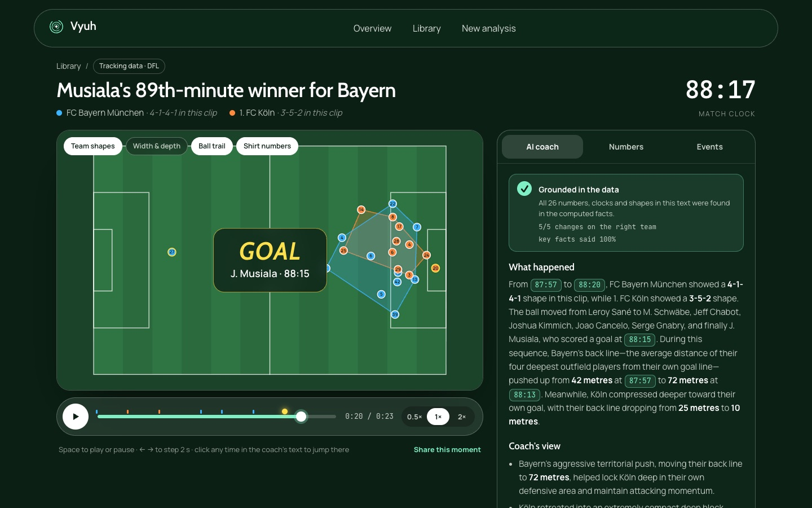
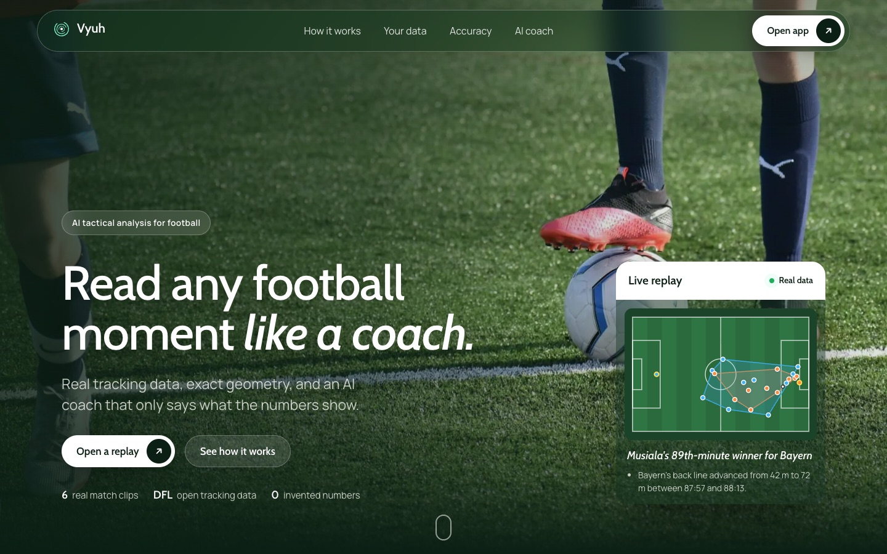
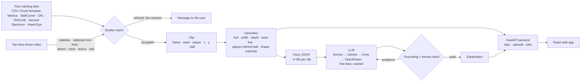

# ⚽ Vyuh · football tactical replay

*Vyuh* is Sanskrit for a battle formation (the Mahabharata's Chakravyuh is the famous one); a football formation is the same idea.

[](https://github.com/Mohitoo6/football-tactical-replay/actions/workflows/tests.yml)

Vyuh replays real football moments from player-tracking data, draws each team's shape as it moves, and has an LLM explain the tactics **using only facts the code has measured**. Every number in the explanation is checked automatically.

**▶ Live demo: [huggingface.co/spaces/Mohitrks/vyuh](https://huggingface.co/spaces/Mohitrks/vyuh)**: the six clips with the replay, numbers and AI coach. Uploading your own data runs locally ([Run it](#run-it)).



*Musiala's 89th-minute winner (1. FC Köln 1–2 FC Bayern München, 27 May 2023). Shaded areas are each team's outfield shape. The coach's text is checked against the measured facts: 26 numbers, clocks and shapes found, 5/5 changes on the right team.*

## Highlights

- **An AI coach that cannot make things up unnoticed.**
  - The LLM only receives measured facts (~4 KB of JSON per clip), and its answer is checked in four layers: every number exists in the facts; every "from X to Y" claim is on the right team and in the right direction; the key facts are covered; no invented events.
  - Results: 6/6 clips grounded; 24/24 claims right; 96% key-fact coverage; 5/5 trap tests passed. In the traps, one fact is changed (the goal removed, the camera made partial...) and the coach must follow it ([D34](DECISIONS.md)).
- **One analysis, many inputs.** All inputs become the same clip after a quality report. The report refuses data it cannot analyse, and says why, instead of guessing.
  - our CSV/Excel template;
  - six provider formats read through [kloppy](https://kloppy.pysport.org): Metrica, SkillCorner, Sportec/DFL, TRACAB, Second Spectrum and Hawk-Eye;
  - a raw top-view drone video.
- **Video to tracking data, measured against GPS ground truth.**
  - From drone footage, with classical computer vision (no training, no GPU).
  - On 6 unseen segments: median position error 0.44 m, 97% of players found, identity kept 92% of the time.
  - A pretrained deep detector was tried, and lost on this footage.
- **A full product, not a notebook.**
  - FastAPI backend: clips, uploads, background jobs.
  - React web app.
  - 137 Python tests and 6 web tests, with CI.
  - A live static demo on Hugging Face Spaces, and a Docker image that runs the full app with uploads.
  - Every decision, with alternatives and evidence, is in [`DECISIONS.md`](DECISIONS.md).

## The web app



- **Library:** six real clips.
  - Four goals from Bundesliga optical tracking (25 frames per second, all 22 players and the ball).
  - Two clips computed from drone video.
- **Replay:**
  - the pitch animated from the data, with team shapes, width and depth, ball trail and shirt numbers;
  - for drone clips, the original video plays in sync beside the replay;
  - the **AI coach** tab (*What happened* · *Coach's view* · *Key numbers*), with a badge showing the grounding checks;
  - a **Numbers** tab with charts of each team's metrics, and an **Events** tab;
  - clocks in the text are clickable and jump to that moment.
- **New analysis:**
  - upload any of the inputs above;
  - for CSV files, a preview of the first moment before upload;
  - the quality report, then the new replay.

The same moment as an exported video (matplotlib renderer, used for offline clips):


## How it works



**Core design principle:**
- Positions come from tracking data, so the geometry starts from real coordinates. The geometry itself is deterministic, tested code.
- The LLM sits only at the top and narrates facts it is given. It never computes or invents numbers, and a checker enforces that.

## Results

| What | How it was measured | Result |
|---|---|---|
| Data quality | 2 full matches, ~6.2 M player positions | 0 positions > 5 m off the pitch; ball never missing; tracking glitches in 0.004 % of moves |
| Orientation | Goalkeeper side per half, 2 matches | 4 / 4 halves correct |
| Generalisation | Ran the pipeline on a second match it was not built on | Worked after fixing 5 issues the first match never showed (D14) |
| Formation estimate | 5-min windows vs official DFL lineups | Settled defensive block: back line 100 %, official shape in top-2 79 %. Team in possession: poor (0–16 %) |
| AI coach | 6 clips, automatic checks + trap tests (D34) | 6/6 grounded; 24/24 claims right; 96 % key-fact coverage; 5/5 traps passed |
| Naive vs strict prompt | Same facts, two prompts | The naive prompt invented a number and two names (caught by the checker); the strict one did not |
| Tests | `uv run pytest`, `npm test` | 115 passing (+22 video tests with `--group video`), 6 web tests; LLM layer tested with fake clients (no network) |

Details: [`evals/formation_eval_J03WMX.md`](evals/formation_eval_J03WMX.md), [`evals/formation_eval_J03WN1.md`](evals/formation_eval_J03WN1.md), [`evals/llm/README.md`](evals/llm/README.md), [`evals/llm/scoreboard.md`](evals/llm/scoreboard.md), [`evals/llm/traps.md`](evals/llm/traps.md).

## From drone video to coaching

The same pipeline also runs on **raw top-view drone video**, with no tracking provider. The system finds the players and the ball itself:

1. Stabilise the hovering drone's drift.
2. Build an empty-pitch image (per-pixel median of the frames).
3. Calibrate from the painted pitch lines.
4. Detect players as blobs that differ from the empty pitch.
5. Track them with a colour-aware tracker, split teams by shirt colour (with an offside-logic goalkeeper rule) and follow the ball.

The result is exported as a normal clip (`clips/drone-0600-0630`), so the overlays and the AI coach work on it unchanged. It works on any clip file:

```bash
uv sync --group video
uv run --group video python scripts/process_video.py my_drone_clip.mp4 --render --explain
```

Before any tracking, the pipeline prints a **quality report**:
- clip length;
- pitch outline shape;
- calibration stable over the clip;
- camera holding still;
- plausible player count;
- enough pixels per metre of pitch (1080p of a full pitch is fine; 720p is not).

If a check fails, it refuses the clip instead of producing wrong positions.

**Accuracy.** Measured on **20 × 30 s SoccerTrack segments** of one match:
- 13 segments were used while building, and 7 were never seen.
- Five of the unseen ones were processed before their ground truth was downloaded.
- The ground truth is used **only for scoring**, with its calibration corrected per segment because the drone drifts ([evals/video](evals/video/README.md), [D19–D30](DECISIONS.md)).

| What | 13 tuned segments: median (worst) | 6 accepted unseen segments: median (worst) |
|---|---|---|
| Players found (recall) | 98.6% (97.7%) | 96.9% (80.0%) |
| Position error, automatic calibration (no hand-marked points) | 0.35 m (0.52 m) | 0.44 m (0.55 m) |
| Identity kept (purity) | 97.4% (91.4%) | 92.5% (84.6%) |
| Correct team | 98.2% (94.3%) | 92.5% (89.5%) |
| Ball correct, all frames | 63% (34%) | 55% (22%) |

- The unseen numbers are the honest ones.
- The quality report refused one unseen segment.
- The ball is the weak part: it is often hidden at players' feet (D25).
- Speed: ~2 min per 30 s of 4K video on an Apple M2 (offline).
- A pretrained deep detector (RF-DETR, tiled) found only 43% of players from straight above, at 100× the cost, so the classical method was kept.

**Robustness** ([evals/video/robustness.md](evals/video/robustness.md), [D27](DECISIONS.md)):
- One segment was edited the ways real clips differ: rotated 90° and 180°, cropped, 30% darker, 1080p, 20 s, 25 fps.
- The pipeline still found 98% of players within 0.55 m on every copy.
- A copy with a goal line cut off, and a 720p copy, were refused.

## Experiment: TV broadcast footage (branch `broadcast-experiment`)

We also tried the usual panning TV camera:
- the camera calibrated in every frame;
- players and ball found with RF-DETR;
- the analysis drawn on the footage.

- **Result:** on one hand-labelled Euro 2020 clip it found 90% of players, but confirmed the ball in only ~20% of frames.
- **Why it is on its own branch:** free broadcast footage to test it on does not exist (broadcast rights), so the drone pipeline stayed the product.
- **Details:** [D28, D29 and D31](DECISIONS.md) and [evals/broadcast](evals/broadcast/README.md).

## Use your own data

Two ways in, one analysis. Both go through a quality report that refuses data it cannot analyse, and says why.

1. **Tracking (coordinate) data:**
   - **Our template**, CSV or Excel ([`templates/tracking_template.csv`](templates/tracking_template.csv)), with one row per player (and the ball) per moment:

     | Column | Meaning |
     |---|---|
     | `time_s` | seconds from the start of the clip |
     | `team` | `home`, `away` or `ball` |
     | `player` | name or number |
     | `x`, `y` | position |
     | `jersey`, `position` | optional; `GK` marks a keeper, otherwise the deepest player in front of goal is taken |

     Positions can be in metres from the centre spot, metres from a corner, or 0–1 along each side. A full example is [`templates/example_musiala_winner.csv`](templates/example_musiala_winner.csv).
   - **Provider formats** through kloppy, cut to a window of up to 120 s:

     | Provider | Files |
     |---|---|
     | Metrica Sports | home CSV + away CSV |
     | SkillCorner | match JSON + tracking JSONL |
     | Sportec / DFL | match information XML + positions XML |
     | TRACAB | metadata XML/JSON + tracking `.dat`/JSON |
     | Second Spectrum | metadata XML/JSON + tracking JSONL |
     | Hawk-Eye | ball files + player centroid files (one per minute; several allowed) |

   - **Tested on:**
     - the example file, which reproduces the bundled clip to 0.01 m;
     - Metrica open data;
     - SkillCorner open data (10 fps);
     - kloppy's sample files for TRACAB, Second Spectrum and Hawk-Eye. A Hawk-Eye minute goes all the way to a clip and a grounded explanation (D37).
2. **A top-view drone video:** see [above](#from-drone-video-to-coaching). It runs locally (minutes of processing).

**Accepted data needs:**
- 3–120 s at 5–60 frames per second;
- at least 7 players per team;
- positions on the pitch (otherwise the units are probably wrong).

**Ball:** without the ball the shapes are still measured, but there are no ball-based facts.

## Backend API

```bash
uv run uvicorn tactics.api:app --reload     # interactive docs at http://localhost:8000/docs
```

| Endpoint | What it does |
|---|---|
| `GET /api/clips` | every clip (bundled and uploaded) |
| `GET /api/clips/{id}?step=2` | frames, players, ball, team shapes (hull, width, depth, area, back line), facts, explanation and its checks; ~76 KB gzipped |
| `GET /api/clips/{id}/source` | the original drone video, to play beside the replay |
| `POST /api/clips/{id}/explanation` | the coach's explanation (cached; one LLM call on a miss) |
| `POST /api/uploads/tracking` | template CSV/Excel → clip, or the reasons it was refused |
| `POST /api/uploads/provider` | provider files + time window → clip |
| `POST /api/uploads/drone`, `GET /api/jobs/{id}` | drone video as a background job with progress (local, needs `--group video`) |
| `GET /api/template`, `GET /api/template/example` | the template and the example file |

Uploaded clips are stored in `data/user_clips/` (git-ignored).

## Run it

**Requirements:**
- macOS or Linux;
- Python 3.11+ with [uv](https://docs.astral.sh/uv/);
- Node.js 20.19+ or 22.12+ for the web app.

The six clips, their videos and explanations are in the repo, so **the app needs no data download and no API keys**.

```bash
git clone https://github.com/Mohitoo6/football-tactical-replay.git
cd football-tactical-replay
uv sync
uv run uvicorn tactics.api:app --reload        # backend API: http://localhost:8000/docs

# in a second terminal: the web app (http://localhost:5173, /api is proxied to the backend)
cd web
npm install --legacy-peer-deps
npm run dev
```

**Tests:**

```bash
uv run pytest                                  # 115 tests (video tests skip without --group video)
cd web && npm test                             # 6 tests
```

**With Docker** (the full app with uploads, as one container: http://localhost:7860):

```bash
docker build -t vyuh .
docker run -p 7860:7860 --env-file .env vyuh   # .env (free LLM keys) is only needed for new explanations
```

**Quick viewer without Node:** `uv run streamlit run app/streamlit_app.py` (http://localhost:8501).

### Rebuild everything from raw data (optional)

1. Download a match's three XML files (match information, events, positions) from the [Sportec Open DFL dataset on figshare](https://doi.org/10.6084/m9.figshare.28196177) into `data/raw/dfl/` (git-ignored). Each positions file is ~400 MB.
2. Then:

```bash
uv run python scripts/check_match.py J03WMX        # health report + suggested clips for every goal
uv run python scripts/build_clips.py               # clips defined in clips/clips.toml
uv run python scripts/render_clip.py --for-app     # videos (needs ffmpeg: brew install ffmpeg)
cp .env.example .env                               # add free API keys (Gemini, Groq, OpenRouter)
uv run python scripts/generate_explanations.py     # cached per clip; re-runs cost nothing
uv run python scripts/evaluate_explanations.py     # scoreboard of the explanations (add --traps for the trap tests)
uv run python scripts/evaluate_formations.py J03WMX
```

## Project layout

```
src/tactics/
  service.py the backend in one place: list, read, create (template, provider, drone video) and explain clips
  api.py     FastAPI app over service.py
  data/      load DFL tracking with kloppy, orient, validate, build/save clips; upload.py reads user data
  video/     drone video to tracking: stabilise, calibrate from lines, detect, track, teams, ball
  geometry/  shape metrics, formation template matching, formation-line links
  viz/       pitch drawing and animation (one FramePainter for stills and video)
  ai/        facts summary, prompt, LLM client with fallbacks/cache/repair, grounding check, evaluation
web/         React + TypeScript web app (Vite): landing page, library, replay + AI coach, upload
templates/   upload template and a full example file
deploy/      the online demo's Space card (scripts/deploy_space.sh builds and uploads the demo; Dockerfile runs the full app)
app/         Streamlit test viewer
scripts/     offline pipeline: check_match, build_clips, render_clip, generate/evaluate explanations, evaluate_formations
clips/       committed clips: players/ball parquet, meta, summary, explanation, video
evals/       formation, video and LLM evaluations
tests/       115 tests + 22 video tests
```

## Scope and limitations

- **Moments, not full matches.**
  - Vyuh explains clips of 3–120 s. This was a scope choice: a full match loads fine on a laptop.
  - Full-match reports would need more design: load a match once, split it into phases, and summarise in two steps (per phase, then the match).
- **Positions only.** The coach does not read pass, shot or tackle event feeds. "Ball carrier" means the nearest player to the ball.
- **Formation estimate:** reliable for a settled defensive block, not for a team in possession, which reshapes as it attacks.
- **Coaching judgement:** the checks catch wrong numbers, teams and directions, but whether a coaching point is wise still needs human review (`evals/llm/`).
- **Industry feeds:** TRACAB, Second Spectrum and Hawk-Eye are tested on sample files only, because full matches are licensed to clubs.
- **Drone video:**
  - It needs a hovering top-down camera with the whole pitch in view, and it was tuned on one ground.
  - A first test on another ground (NASK, Poland) found new failure modes: lighting changes, shadows, people on the touchline. That work is in progress.
- **Free hosting:** the online demo is a static site (free Docker hosting now needs a paid plan). It shows the six clips with their cached explanations; uploads and new explanations run locally or in Docker.

## Data and attribution

- **Tracking and event data:** **Sportec Open DFL Tracking and Event Data**. Bassek, M., Rein, R., Weber, H. & Memmert, D. *An integrated dataset of spatiotemporal and event data in elite soccer.* Scientific Data 12, 195 (2025). doi:[10.1038/s41597-025-04505-y](https://doi.org/10.1038/s41597-025-04505-y). Licensed **CC-BY 4.0**.
- **Drone video and ground truth:** **SoccerTrack**, Scott et al., CVPR Workshops 2022 ([Kaggle](https://www.kaggle.com/datasets/atomscott/soccertrack)), LGPL-3.0. The drone clips contain positions we computed, a rendered video, and the matching 30 s of the original video (re-encoded, same LGPL-3.0 licence) to play beside the replay. The full raw videos are not redistributed.
- **Upload testing (not redistributed):**
  - Metrica Sports sample data ([github.com/metrica-sports/sample-data](https://github.com/metrica-sports/sample-data));
  - SkillCorner open data ([github.com/SkillCorner/opendata](https://github.com/SkillCorner/opendata));
  - the NASK top-view dataset ([Zenodo 14867795](https://zenodo.org/records/14867795), CC BY 4.0);
  - kloppy's sample provider files.
- **Images on the web app:** sources and licences in [`web/public/img/CREDITS.md`](web/public/img/CREDITS.md).
- **Built with:**
  - Python: kloppy, mplsoccer, numpy, scipy, pandas, OpenCV, FastAPI, Streamlit;
  - web: React, Vite, GSAP;
  - LLMs: the OpenAI-compatible APIs of Google Gemini, Groq and OpenRouter.

## License

- **Code:** [MIT](LICENSE).
- **Data:** the tracking-derived files in `clips/` (positions, summaries, videos) come from the Sportec Open DFL dataset and remain under **CC-BY 4.0**. If you reuse them, credit Bassek et al. (2025) as above.

## Authors

Co-built by two brothers:

- **Rohit** ([@Rohit-0612](https://github.com/Rohit-0612)): Phases 1–4.
  - data pipeline, orientation and validation;
  - geometry and formation detection;
  - visualisation.
- **Mohit** ([@Mohitoo6](https://github.com/Mohitoo6)):
  - the AI layer (facts summary, prompts, fallbacks, caching, grounding, repair) and its evaluation (Phases 5–6);
  - video-to-tracking from drone footage (Phase 7) and the TV-footage experiment (Phase 8);
  - the backend API (Phase 9) and the web app.

Developed with Claude Code as a pair programmer; every decision and its evidence is recorded in `DECISIONS.md`.
